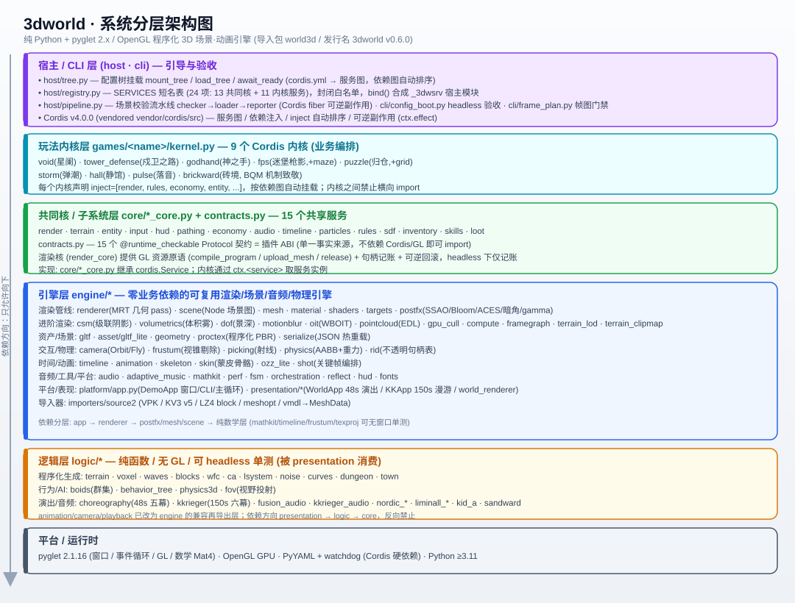
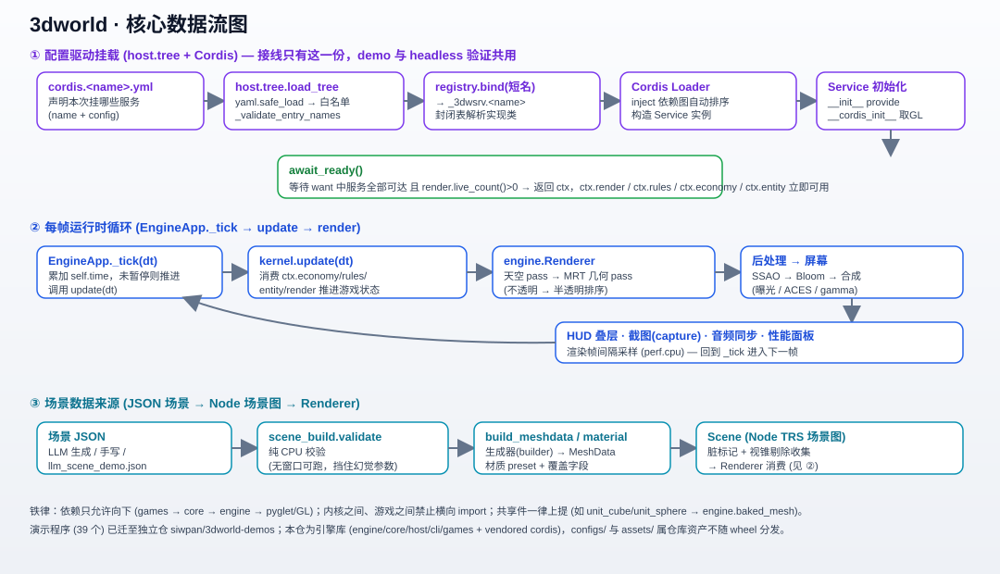

# 3dworld · 架构与设计文档

> 分析对象：`D:\projects\repos\3dworld`（导入包 `world3d`，发行名 `3dworld`，v0.6.0）
> 性质：**纯 Python + pyglet 2.x / OpenGL** 的「程序化优先、确定性、可 headless 验证」3D 场景·动画引擎（零外部素材）。
> 配套图：`3dworld_architecture.svg`（分层架构）、`3dworld_dataflow.svg`（核心数据流）。

---

## 0. 项目速览

| 项 | 值 |
|----|----|
| 定位 | 引擎**库**（演示程序 39 个已剥离至独立仓 `siwpan/3dworld-demos`） |
| 导入/发行名 | `import world3d` / pip 包 `3dworld`（Python 包名不能以数字开头） |
| 技术栈 | Python ≥3.11 · pyglet 2.1.16 · OpenGL (GLSL 330 core) · vendored Cordis v4.0.0 |
| 运行时依赖 | `pyglet`、`PyYAML>=6,<7`、`watchdog>=4,<7`（Cordis 硬依赖） |
| 规模 | `world3d/` 下 **162 个 .py**；9 个玩法内核；15 个共同核服务；10 棵配置树 |
| 治理 | 机械门禁 `verify.py`(15 条) + `check_imports.py`；pre-commit + GitHub Actions CI（win + ubuntu EGL） |

**一句话架构**：用 **Cordis 服务图**把「配置树 (`configs/*.yml`)」所描述的共同核 + 玩法内核**声明式挂载**起来；内核通过 `ctx.<service>` 消费 15 个共同核（渲染/地形/实体/经济/规则/音频/时间轴/粒子/SDF…），引擎层 (`engine/`) 提供零业务依赖的可复用渲染与场景能力，逻辑层 (`logic/`) 提供纯函数、可 headless 单测的程序化生成与行为算法。

---

## 1. 系统分层架构



依赖铁律：**只允许向下** `games → core → engine → pyglet/GL`；`presentation → logic → core`，反向禁止；内核之间、游戏之间**不得横向 import**（共享件一律上提）。

### 1.1 宿主 / CLI 层（`host` · `cli`）
引导与验收中枢，也是 Cordis 的接线面。

- **`host/tree.py`** — 配置树挂载统一入口：`load_tree(ctx, path)`（Cordis `Loader` + drain 子插件）、`await_ready(ctx, …)`（等 `want` 服务可达且 `render.live_count()>0`）、`mount_tree(path, want)`（一键 `Context → 挂树 → 等就绪`）。demo 与 headless 验证**走同一条**挂载路径。
- **`host/registry.py`** — `SERVICES` 短名表（24 项：13 共同核 + 11 内核服务，其中 `fps/maze`、`puzzle/grid` 同模块双服务）。封闭白名单；`bind(name)` 为每个短名合成 `_3dwsrv.<name>` 宿主模块（只含 `default`），塞进 `sys.modules`。
- **`host/pipeline.py`** — 场景校验流水线（Cordis fiber 可逆副作用）：`SceneCheckService → LoaderService(inject scene_check) → ReporterService(inject scene)`，演示「卸载即回滚 / 依赖消失自动停用」。
- **`cli/config_boot.py`** — 9 内核 + 13 共同核的 headless 验收；**`cli/frame_plan.py`** — 帧图门禁（16 种效果组合计划必须合法且顺序正确）。
- **Cordis v4.0.0**（vendored `vendor/cordis/src`，经 `world3d._cordis_locate` 优先已安装、回退源码）：提供 `Context` / `Loader` / `Service` / `inject` 依赖图自动排序 / `ctx.effect` 可逆副作用。

> 安全点：`.yml` 的 `name` 会被 Cordis `importlib.import_module` 直接导入（≈执行代码）。`_validate_entry_names` 强制白名单（`_3dwsrv.` / `core.` / `games.` 前缀），把「评审绕过」钉死。

### 1.2 玩法内核层（`games/<name>/kernel.py`）
9 个 Cordis 内核，是**业务编排**所在：

`void`(星阑) · `tower_defense`(戍卫之路) · `godhand`(神之手) · `fps`(迷堡枪影, +maze) · `puzzle`(归仓, +grid) · `storm`(弹潮) · `hall`(静馆) · `pulse`(落音) · `brickward`(砖境, BQM 机制致敬)

每个内核只声明 `inject = ['render','rules','economy','entity', …]`，由 Cordis 按依赖图**自动排序挂载**，内核之间零耦合。

### 1.3 共同核 / 子系统层（`core/*_core.py` + `contracts.py`）
**15 个共享服务**（`CORES` 表）：`render · terrain · entity · input · hud · pathing · economy · audio · timeline · particles · rules · sdf · inventory · skills · loot`。

- **`core/contracts.py`** — 15 个 `@runtime_checkable` **Protocol 契约 = 插件 ABI**（单一事实来源）。只 `import typing`，**无 Cordis / 无 GL 也能 import**；`verify()` 核对每个契约声明的「现有模块」真能 import。
- **`core/render_core.py`** — 渲染共同核 `RenderService`：只提供 GL 资源**原语**（`compile_program` / `upload_mesh` / `release`）与绘制入口，**不持有游戏状态**；headless 下仅做句柄记账与回滚语义（可逆副作用），`live_count()` 供 `await_ready` 判定就绪。
- 其余核：地形高度场编辑、实体注册表、A*+编队寻路、KV 经济、程序化音频、时间轴/关键帧、GPU 粒子数值步进、SDF/体素、背包/技能/掉落、波次/胜负规则。

### 1.4 引擎层（`engine/*`）
零业务依赖的可复用引擎，是 `core/logic/presentation` 的**公共下沉层**。

- **渲染管线**：`renderer`(MRT 几何 pass) · `scene`(Node 场景图) · `mesh` · `material`(PBR 金属-粗糙度) · `shaders`(全 GLSL 330) · `targets`(MRT/Mip 渲染目标) · `postfx`(SSAO + Bloom 金字塔 + 合成：曝光/ACES/暗角/gamma)。
- **进阶渲染**：`csm`(级联阴影) · `volumetrics`(体积雾/光轴) · `dof`(景深) · `motionblur`(相机重投影) · `oit`(WBOIT 顺序无关透明) · `pointcloud`(EDL) · `gpu_cull`(compute 剔除+LOD+命令生成, 含 CPU 回退) · `compute`(GPU 计算调度) · `framegraph`(声明→编译期校验→剔除→拓扑排序→别名/槽位池) · `terrain_lod`(CDLOD) · `terrain_clipmap`(几何 clipmap)。
- **资产/场景**：`gltf` · `asset/gltf_lite` · `geometry`(程序化几何) · `proctex`(程序化 PBR 纹理) · `serialize`(JSON 序列化 + 热重载 watcher)。
- **交互/物理**：`camera`(Orbit/Fly) · `frustum`(Gribb-Hartmann 视锥剔除) · `picking`(射线 AABB/球/三角形) · `physics`(AABB+重力+move-and-slide) · `rid`(不透明句柄表)。
- **时间/动画**：`timeline` · `animation` · `skeleton`(层级骨骼) · `skin`(蒙皮骨骼) · `ozz_lite` · `shot`(关键帧编排)。
- **音频/工具/平台**：`audio` · `adaptive_music` · `mathkit`(矩阵/四元数/插值) · `perf`(p1/jank + GPU 计时) · `fsm` · `orchestration`(事件总线 when→then) · `reflect`(反射注册表：序列化/编辑器/脚本绑定一源驱动) · `hud` · `fonts`(CJK 兜底)。
- **平台/表现**：`platform/app.py`(`DemoApp` 窗口/CLI/主循环骨架) · `presentation/*`(`WorldApp` 48s 五幕演出 · `KKApp` 150s 漫游 · `world_renderer`)。
- **导入器**：`importers/source2`(VPK / KV3 v5 / LZ4 block / meshopt / vmdl→MeshData)，零依赖解析 Valve Source 2 资源。

> `engine/__init__.py` 用 `_safe` 延迟导入保证「无 GL 上下文也能 import engine」；公共面由 `__all__` 收口，`world3d/__init__.py` 再转发。

### 1.5 逻辑层（`logic/*`）
**纯函数 / 无 GL / 可 headless 单测**，被 `presentation` 消费（依赖方向 `presentation → logic → core`）。

- 程序化生成：`terrain` · `voxel` · `waves`(Gerstner) · `blocks` · `wfc` · `ca` · `lsystem` · `noise` · `curves` · `dungeon` · `town`
- 行为/AI：`boids`(Reynolds 群集) · `behavior_tree` · `physics3d` · `fov`(递归阴影投射视野)
- 演出/音频：`choreography`(48s 五幕+逆运动学) · `kkrieger`(150s 六幕) · `fusion_audio` · `kkrieger_audio` · `nordic_*` · `liminall_*` · `kid_a` · `sandward`
- 兼容再导出层：`animation` / `camera` / `playback` 已改为 `engine` 同名件的转发层（旧测试全绿）。

### 1.6 平台 / 运行时
`pyglet 2.1.16`（窗口/事件循环/`pyglet.gl`/`pyglet.math.Mat4`）· OpenGL GPU · `PyYAML` + `watchdog`（Cordis 硬依赖）。

---

## 2. 核心模块关系（谁消费谁）

```
configs/cordis.<name>.yml
        │ (name 短名 → host.registry.bind → _3dwsrv.<name> 宿主模块)
        ▼
host.tree.load_tree ──▶ Cordis Loader (inject 依赖图自动排序)
        │
        ▼
games/<name>/kernel.py  (Service, inject=[render, rules, economy, entity, ...])
        │  消费 ↓ 通过 ctx.<service>
        ├──────────────▶ core/*_core.py   (15 共同核；render_core 管 GL 资源原语)
        │                        │ 调用 ↓
        │                        ▼
        │                  engine/*  (renderer/scene/mesh/shaders/postfx/...)
        │                        │ 依赖 ↓
        │                        ▼
        │                  pyglet / OpenGL
        └──────────────▶ logic/*  (纯函数：程序化生成 / 行为 / 演出，经 presentation 接入)
```

消费关系要点：
- **内核不直接碰 GL**——所有 GPU 资源经 `ctx.render`（`RenderService`）的 `compile_program`/`upload_mesh`/`release` 原语创建与回收，句柄记入 `live_count()`。
- **内核不改变引擎**——`engine/` 是通用件；同一份 `Renderer` / `Scene` 被 9 个内核共用。
- **确定性**：`void` 内核的价格/事件冲击由 `(seed, station, good)` 派生相位，同种子同世界，录制与验收可锁定（单测 `test_noise` 还做 golden 交叉验证）。

---

## 3. 核心数据流



### 3.1 配置驱动挂载（启动，boot）
1. `configs/cordis.<name>.yml` 声明「本次挂哪些服务 + 各自 config」。
2. `host.tree.load_tree`：`yaml.safe_load` → `_resolve_service_names`（短名经 `registry.bind` 换成 `_3dwsrv.<name>`）→ `_validate_entry_names`（白名单）→ `loader.root.update(data)`。
3. Cordis `Loader` 按 `inject` 依赖图**自动排序**构造各 `Service`。
4. 每个 `Service.__cordis_init__` 取 GL 句柄 / 生成实体 / 用 `ctx.effect(...)` 登记可逆副作用。
5. `await_ready(want)` 等 `want` 中服务全部可达且 `render.live_count()>0`，返回 `ctx`。

> 「demo 怎么挂的 = 验证怎么挂的」：examples 与 `cli/config_boot` 共用 `mount_tree` 与同一组 `WANT_*` 列表，**不存在两套接线**。

### 3.2 每帧运行时循环
`EngineApp._tick(dt)` → 累加 `self.time` → `update(dt)`（内核经 `ctx.economy/rules/entity/render` 推进游戏状态）→ `render()`（`engine.Renderer` 跑：天空 pass → MRT 几何 pass 不透明→半透明排序 → SSAO → Bloom → 合成曝光/ACES/gamma → 屏幕）→ HUD 叠层 / 截图 `capture` / 音频同步 / `perf` 采样 → 回到下一帧。

`platform/app.py` 的 `DemoApp` 与 `engine/app.py` 的 `EngineApp` 是同一骨架的两份：前者供独立演示仓、后者是引擎库内的统一入口，均统一命令行（`--smoke/--shot/--bench/--size/--flag`）。

### 3.3 场景数据来源
场景 JSON（LLM 生成 / 手写）→ `engine.scene_build.validate`（**纯 CPU 校验**，无窗口可跑，挡住 LLM 幻觉参数）→ `build_meshdata` / `build_material`（生成器 `builder` → `MeshData`）→ `Scene`（Node TRS 场景图，脏标记 + 视锥剔除收集）→ 被 `Renderer` 消费。`serialize.py` 提供 JSON 热重载 watcher。

---

## 4. 关键技术决策与踩坑（精选，均真机复现）

| 主题 | 决策 / 结论 |
|------|-------------|
| 环境贴图 | 等距柱状 equirect（非立方体贴图，pyglet 无 CubeMap 类） |
| IBL 镜面 | 逐 mip 级 GGX 重要性采样 + `textureLod(roughness*maxLod)`，非单张大模糊核 |
| G-buffer | MRT 两张（HDR 颜色 + 视空间法线/线性深度），非全延迟 |
| `debug_gl` | 关掉 `pyglet.options['debug_gl']`（每 GL 调用 `glGetError` 往返占每帧 Python 耗时 ~44%）→ 基准 28.7→114.7 fps |
| **P0 模型矩阵 uniform 去重 bug** | `Mesh.draw()` 原按「本网格上次传了什么」去重，导致第 2 帧起多网格共用 program 级 uniform 互相覆盖，画面塌到最后一物。修复：去重键改为「该 program 当前装着的矩阵」（模块级 `_MODEL_UNIFORM`）；守卫 `test_gl_multimesh_frame_stability`（连续三帧逐字节一致）。 |
| 横向依赖清理 | `unit_cube/unit_sphere` 曾被 6 个内核横向 import（游戏 A 依赖游戏 B），迁至 `engine.baked_mesh`；「删定义」与「补 import」必须在同一次改动完成（否则 `NameError` 被 Cordis Loader 吞成「服务不就绪」）。 |
| 可逆副作用 | Cordis `ctx.effect` 绑定 fiber，dispose 时统一回滚；内核 GL 资源经 `render.release` + `ctx.effect` 注册，卸载即回收。 |
| headless 验证 | `render_core` 不真开 GL 也完整执行记账/回滚语义；CI 用 `PYGLET_HEADLESS=1` + EGL(llvmpipe) 跑无显示器用例。 |
| DPI 坑 | 统一 `pyglet.options['dpi_scaling']='real'`（否则 viewport 乘 scale 渲染放大裁切）。 |

---

## 5. 质量保障（门禁 + 测试 + CI）

- **`scripts/verify.py`（15 条，<1 秒，pre-commit 跑）**：「同一事实写在两处必须相等」——README 测试命令表 ↔ `run_all_tests.MODULES`、测试计数、配置树/内核/共同核计数、`docs/README.md` 新鲜度、文档相对链接、CLI 命令可达、`pyrefs` 模块存在、`scaffold` 模板真 import 并跑到 `won`、workflows 结构。`--selfcheck` 逐条注入破坏并断言变红（16/16 全拦得住）。
- **`scripts/check_imports.py`**：`world3d/` 下 162 模块逐个 import（单测只覆盖被引用模块，这是「改漏」唯一防线）；落有不变量「仓库内自带 `__init__.py` 的目录不许出现在 `sys.path`」（曾因 `world3d/platform/` 遮蔽标准库 `platform` 触发 `AttributeError`）。
- **测试套件**：逻辑层 65 项、共同核 17 项、引擎层 30 项、着色器 5、噪声 8、回放 9、行为树 10、地牢 6、城镇 5、CA 9、曲线 9、3D 物理 12、L-System 10、WFC 7、蒙皮 8、GPU 剔除 7、帧图 v1/v2 各 17、地形 LOD 18、双贪心网格 13、几何 clipmap 15、Jolt 17、Box2D 6、ozz 12、材质缓存 11、glTF 11、RID 11、reflect 11…（45 个聚合模块，由 `run_all_tests.py` 跑）。
- **CI**：`windows-latest`（真窗口真驱动，GL 真跑）+ `ubuntu-latest`（无显示器/无 GPU 经 EGL 软渲），挂 `verify.py` + `check_imports.py`。

---

## 6. 模块清单速查（按层）

| 层 | 关键模块 |
|----|---------|
| host/cli | tree · registry · pipeline · cli/config_boot · cli/frame_plan |
| games (9) | void · tower_defense · godhand · fps(+maze) · puzzle(+grid) · storm · hall · pulse · brickward |
| core (15) | contracts · render_core · terrain_core · entity_core · pathing_core · economy_core · audio_core · timeline_core · particles_core · rules_core · sdf_core · inventory_core · skills_core · loot_core · (input/hud 部分已具备) |
| engine | renderer · scene · mesh · material · shaders · targets · postfx · csm · volumetrics · dof · motionblur · oit · pointcloud · gpu_cull · compute · framegraph · terrain_lod · terrain_clipmap · gltf · geometry · proctex · serialize · camera · frustum · picking · physics · rid · timeline · animation · skeleton · skin · ozz_lite · shot · audio · adaptive_music · mathkit · perf · fsm · orchestration · reflect · hud · fonts · platform/app · presentation/* · importers/source2 |
| logic | terrain · voxel · waves · blocks · wfc · ca · lsystem · noise · curves · dungeon · town · boids · behavior_tree · physics3d · fov · choreography · kkrieger · fusion_audio · kkrieger_audio · nordic_* · liminall_* · kid_a · sandward |
| runtime | pyglet 2.1.16 · OpenGL · PyYAML · watchdog · Python ≥3.11 |

---

## 7. 延伸阅读（`docs/`）

- `引擎设计.md` — 模块地图 + 渲染管线 + 实测踩坑（最权威的引擎内部文档）
- `共同核契约手册.md` — 15 共同核契约总览（与 `core/contracts.py` 双向一致，受门禁 `cores-doc-pairs` 守护）
- `5_引擎化改造规划.md` — P0~P5 引擎化路线图（分层归位、命名、版本双轨）
- `cordis集成.md` — Cordis v4.0.0 接线细节
- `引擎源码架构调研/` · `开源引擎源码架构调研.md` — 外部引擎调研
- `借鉴记账.md` — 致敬/复刻来源与许可证（合规）
- `openapi.yaml` — 场景 JSON 契约的 OpenAPI v3 规范
